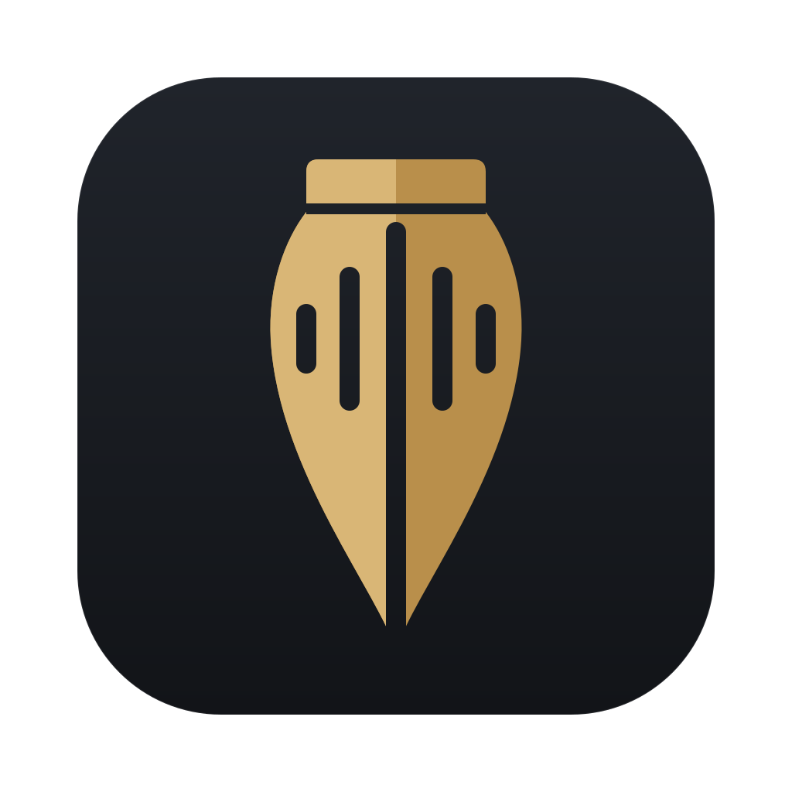

<p align="center"></p>

<h1 align="center">Silas</h1>
<p align="center"><em>Speak. Silas writes.</em></p>

Silas is private, on-device dictation for macOS, Windows and Linux. Hold a key, speak,
let go, and Silas types what you said into whatever app has focus. It types real
keystrokes, so apps never show a paste prompt and your clipboard is left alone. It learns
your words as you fix them.

## Install

**macOS** (stable, Apple silicon):

```sh
curl -fsSL https://raw.githubusercontent.com/baney75/silas/main/install.sh | sh
```

**Linux** (nightly, x86_64, glibc 2.39 or newer, e.g. Ubuntu 24.04+): the same command. It installs the `.deb` or `.rpm` when it can,
otherwise an AppImage plus a udev rule so Silas can read the hold-to-talk key.

**Windows** (nightly), in PowerShell:

```powershell
irm https://raw.githubusercontent.com/baney75/silas/main/install.ps1 | iex
```

On first launch Silas downloads its speech model (478 MB) while you grant permissions.
On macOS it needs **Microphone** and **Accessibility** (to read the key and to type).

## Use it

| Do this | And Silas |
| --- | --- |
| Hold **Right ⌘** (Mac) or **Right Ctrl** (Windows, Linux), speak, release | types what you said |
| Tap the key once | listens hands-free until you tap it again |
| Press **Esc** while it listens | cancels |
| Press the key with another key (Right ⌘ + C) | does nothing; your shortcut still works |

New lines are typed as Shift+Return, so chat boxes don't send early. Change the key,
typing speed and the rest in Settings.

## It learns

- **Fix it where it typed.** Right after Silas types, backspace over a wrong word and type
  the right one. Silas follows the edit. A name it didn't know ("Parish1") is learned at
  once; an ordinary word is learned the second time you make the same fix.
- **Fix it in History.** Click *Teach a fix* on any dictation, edit the text, save.
- **Add words.** Dictionary → Words takes names and jargon; Corrections maps what it hears
  to what you mean. Import a TypeWhisper export or another Silas dictionary.

Silas only bends rare words toward your dictionary. Everyday English ("better", "make sure")
is never rewritten into jargon, which is the failure that made us leave TypeWhisper.

## Models

| Model | Size | Speed (M-series CPU) | Notes |
| --- | --- | --- | --- |
| **Parakeet v3** (default) | 478 MB | ~12x real time; a short dictation in 0.2–0.8 s | 25 European languages |
| Cohere Transcribe (int4) | 2 GB | ~2x real time | Cleaner punctuation; dropped text on a 72 s clip in testing |

Measured on eight real dictations (175 s of speech) with `silas-bench`.

### The right model for your computer

Silas picks the model for your computer by itself:

1. It looks your computer up (operating system, processor, core count) in the
   [device registry](registry/devices.json). If your kind of computer is there, it uses that model.
2. If not, once the default model is ready it measures it in the background on a minute of public
   recordings with known text ([LibriSpeech](https://www.openslr.org/12), CC BY 4.0), along with every
   other model you've already downloaded (Silas downloads nothing for this). A model passes when it
   runs at least **10x real time** (10 s of speech ready in 1 s) and gets at least **92% of words**
   right. Silas switches to the most accurate model that passes. If none passes, it shows the
   numbers and keeps your model. Measuring the other models starts only after 30 seconds without
   dictation, and while it runs it can make a dictation slower.
3. You can still pick any model. Once you choose one, Silas never switches it for you.

**Share results** opens a GitHub issue with your device type, OS, Silas version and the numbers.
No audio or dictated text is sent. A bot checks the report and comments; once a maintainer approves
it, everyone with the same computer gets your result. `silas-bench suite` runs the same measurement
from a terminal.

## Updates

| Channel | Platforms | Source |
| --- | --- | --- |
| Stable | macOS | `vX.Y.Z` releases, built and signed on the maintainer's Mac (`scripts/release-stable.sh`) |
| Nightly | macOS, Windows, Linux | the rolling `nightly` pre-release, rebuilt by CI each night when `main` changed |

Silas checks at launch and every four hours. With auto-update on, it installs once it has
been idle for two minutes. Each channel has its own signing key, and Silas refuses an update
that isn't signed by its channel's key. The stable key never leaves the release Mac. Mac nightly
builds are ad-hoc signed, so macOS asks for Accessibility again after each nightly update.

## Build from source

```sh
bun install
bunx tauri dev                      # run
(cd src-tauri && cargo test --lib)  # tests
bunx tauri build                    # package
```

Linux needs `libwebkit2gtk-4.1-dev libappindicator3-dev librsvg2-dev libasound2-dev libudev-dev libxdo-dev`.

## Privacy

Audio never leaves the computer. Silas listens only while the key is held (or hands-free
is on), and keeps history and the dictionary as JSON in its app-data folder.

## Credits

Speech engines through [transcribe-rs](https://github.com/cjpais/transcribe-rs) (MIT), keys
through [handy-keys](https://github.com/handy-computer/handy-keys) (MIT); both come from the
[Handy](https://github.com/cjpais/Handy) project. Parakeet is NVIDIA's (CC-BY-4.0). The benchmark
clips come from [LibriSpeech](https://www.openslr.org/12) (CC BY 4.0; Panayotov et al., ICASSP 2015). The
common-word list comes from [FrequencyWords](https://github.com/hermitdave/FrequencyWords)
(CC-BY-SA-4.0 content).

MIT licensed. © 2026 Donovan Baney.
