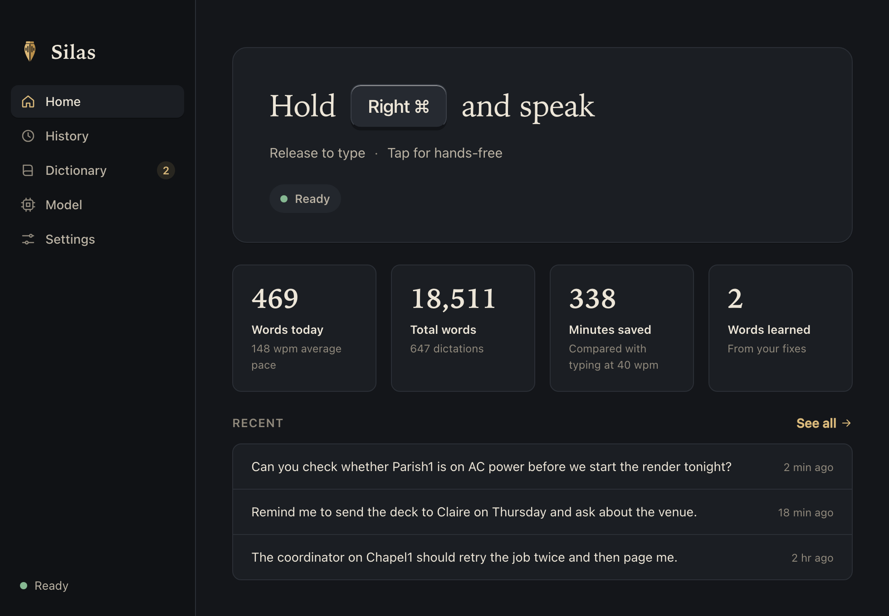

<p align="center"></p>

<h1 align="center">Silas</h1>
<p align="center"><em>Speak. Silas writes.</em></p>

Silas is private, on-device dictation for macOS, Windows and Linux. Hold a key, speak,
let go, and Silas types what you said into whatever app has focus. It types real
keystrokes, so apps never show a paste prompt and your clipboard is left alone. It learns
your words as you fix them.

<p align="center"></p>

## Install

Paste one line into a terminal. It downloads Silas, installs it and opens it.

**macOS** (Apple silicon, macOS 12 or newer):

```sh
curl -fsSL https://raw.githubusercontent.com/baney75/silas/main/install.sh | sh
```

**Windows** (10 or 11, 64-bit), in PowerShell:

```powershell
irm https://raw.githubusercontent.com/baney75/silas/main/install.ps1 | iex
```

**Linux** (x86_64, glibc 2.39 or newer, e.g. Ubuntu 24.04+ or Fedora 40+): the macOS line. It
installs the `.deb` on Debian and Ubuntu, the `.rpm` on Fedora and openSUSE Tumbleweed, and otherwise an
AppImage with a launcher entry and a udev rule so Silas can read the hold-to-talk key.

Run the same line again to update by hand. Silas also updates itself.

<details>
<summary>Rather download it yourself?</summary>

- **macOS:** [Silas_aarch64.dmg](https://github.com/baney75/silas/releases/latest/download/Silas_aarch64.dmg).
  Drag Silas to Applications and open it. Silas isn't notarized by Apple yet, so the first time
  macOS says it can't verify the app. Click **Done**, open **System Settings › Privacy &
  Security**, scroll down and click **Open Anyway**. The one-line installer skips this step.
- **Windows and Linux:** the `.exe`, `.deb`, `.rpm` and `.AppImage` are on the
  [nightly release](https://github.com/baney75/silas/releases/tag/nightly). Windows SmartScreen
  may warn about a new app: click **More info › Run anyway**.

</details>

### First run

1. Silas opens a short setup. The speech model (478 MB) starts downloading right away.
2. On macOS, click **Allow** for **Microphone**, then turn on Silas under **Accessibility**.
   Silas moves on by itself once both are on. Windows asks for nothing. On Linux the installer
   already granted keyboard access; if setup says it can't see your key, log out and back in once.
3. Try it in the practice box: hold the key, say a sentence, let go.

Silas lives in the menu bar (macOS) or system tray. Close the window and it keeps listening
for your key.

## Use it

| Do this | And Silas |
| --- | --- |
| Hold **Right ⌘** (Mac) or **Right Ctrl** (Windows, Linux), speak, release | types what you said |
| Tap the key once | listens hands-free until you tap it again |
| Press **Esc** while it listens | cancels |
| Press the key with another key (Right ⌘ + C) | does nothing; your shortcut still works |

New lines are typed as Shift+Return, so chat boxes don't send early. Change the key,
typing speed and the rest in Settings.

## It learns

- **Fix it where it typed.** Right after Silas types, backspace over a wrong word and type
  the right one. Silas follows the edit. A name it didn't know ("Parish1") is learned at
  once; an ordinary word is learned the second time you make the same fix.
- **Fix it in History.** Click *Teach a fix* on any dictation, edit the text, save.
- **Add words.** Dictionary → Words takes names and jargon; Corrections maps what it hears
  to what you mean. Import a TypeWhisper export or another Silas dictionary.

Silas only bends rare words toward your dictionary. Everyday English ("better", "make sure")
is never rewritten into jargon, which is the failure that made us leave TypeWhisper.

## Models

| Model | Size | Speed (M-series CPU) | Notes |
| --- | --- | --- | --- |
| **Parakeet v3** (default) | 478 MB | ~12x real time; a short dictation in 0.2–0.8 s | 25 European languages |
| Cohere Transcribe (int4) | 2 GB | ~2x real time | Cleaner punctuation; dropped text on a 72 s clip in testing |

Measured on eight real dictations (175 s of speech) with `silas-bench`.

## Updates

| Channel | Platforms | Source |
| --- | --- | --- |
| Stable | macOS | `vX.Y.Z` releases, built and signed on the maintainer's Mac (`scripts/release-stable.sh`) |
| Nightly | macOS, Windows, Linux | the rolling `nightly` pre-release, rebuilt by CI each night when `main` changed |

Silas checks at launch and every four hours. With auto-update on, it installs once it has
been idle for two minutes. Each channel has its own signing key, and Silas refuses an update
that isn't signed by its channel's key. The stable key never leaves the release Mac. Mac nightly
builds are ad-hoc signed, so macOS asks for Accessibility again after each nightly update.

## If something's off

| Problem | Fix |
| --- | --- |
| Holding the key does nothing (macOS) | System Settings › Privacy & Security › Accessibility: turn Silas off and on again. After a nightly update macOS may need this once more. |
| Words are typed into the wrong place | Silas types where the dictation started. Click into the field before you hold the key. |
| Nothing is typed into a Wayland app (Linux) | Install `wtype`. |
| The AppImage won't start (Linux) | Install your distro's FUSE 2 package (`libfuse2` or `fuse2`). |

Still stuck? [Open an issue](https://github.com/baney75/silas/issues/new) with your OS and
what you saw.

## Uninstall

Your dictionary, history and voice model are kept, so a reinstall picks up where you left off.

```sh
curl -fsSL https://raw.githubusercontent.com/baney75/silas/main/install.sh | sh -s -- --uninstall
```

```powershell
& ([scriptblock]::Create((irm https://raw.githubusercontent.com/baney75/silas/main/install.ps1))) -Uninstall
```

To erase everything, also delete the `Silas` folder in `~/Library/Application Support` (macOS),
`%APPDATA%` (Windows) or `~/.local/share` (Linux).

## Build from source

```sh
bun install
bunx tauri dev                      # run
(cd src-tauri && cargo test --lib)  # tests
bunx tauri build                    # package
```

Linux needs `libwebkit2gtk-4.1-dev libappindicator3-dev librsvg2-dev libasound2-dev libudev-dev libxdo-dev`.

## Privacy

Audio never leaves the computer. Silas listens only while the key is held (or hands-free
is on), and keeps history and the dictionary as JSON in its app-data folder.

## Credits

Speech engines through [transcribe-rs](https://github.com/cjpais/transcribe-rs) (MIT), keys
through [handy-keys](https://github.com/handy-computer/handy-keys) (MIT); both come from the
[Handy](https://github.com/cjpais/Handy) project. Parakeet is NVIDIA's (CC-BY-4.0). The
common-word list comes from [FrequencyWords](https://github.com/hermitdave/FrequencyWords)
(CC-BY-SA-4.0 content).

MIT licensed. © 2026 Donovan Baney.
