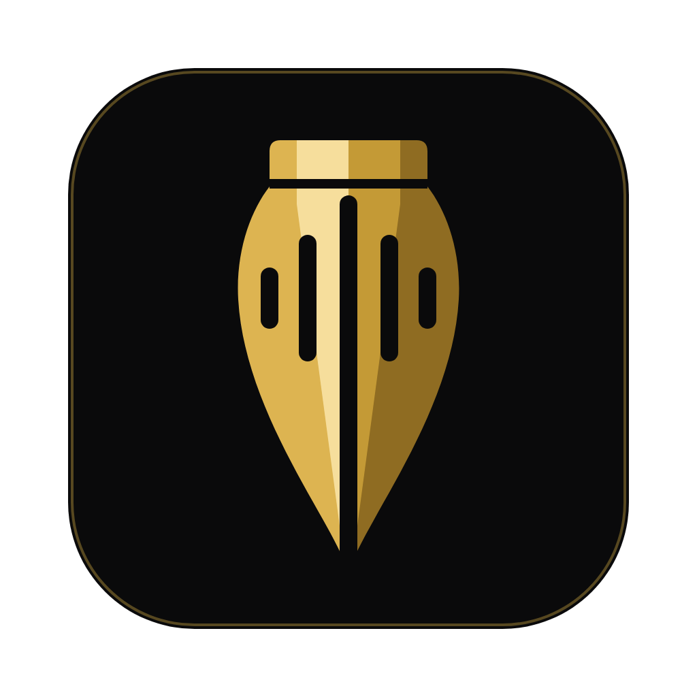
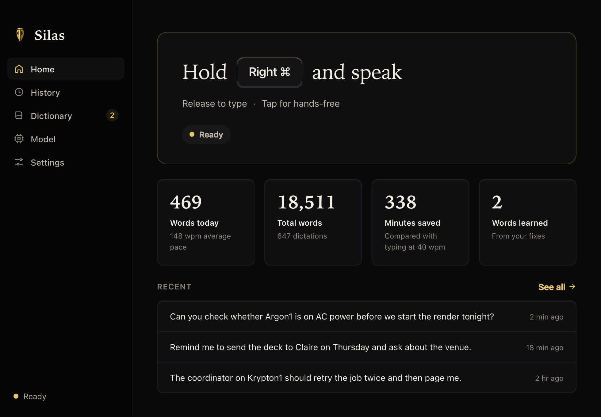

<p align="center"></p>

<h1 align="center">Silas</h1>
<p align="center"><em>Speak. Silas writes.</em></p>

Silas is private, on-device dictation for macOS, Windows and Linux. Hold a key, speak,
let go, and Silas types what you said into whatever app has focus. It types real
keystrokes, so apps never show a paste prompt and your clipboard is left alone. It learns
your words as you fix them.

<p align="center"></p>

## Install

Paste one line into a terminal. It downloads Silas, installs it and opens it.

**macOS** (Apple silicon, macOS 12 or newer):

```sh
curl -fsSL https://raw.githubusercontent.com/baney75/silas/main/install.sh | sh
```

**Windows** (10 or 11, 64-bit; nightly builds), in PowerShell:

```powershell
irm https://raw.githubusercontent.com/baney75/silas/main/install.ps1 | iex
```

**Linux** (x86_64, glibc 2.39 or newer, e.g. Ubuntu 24.04+ or Fedora 40+; nightly builds): the macOS line. It
installs the `.deb` on Debian and Ubuntu, the `.rpm` on Fedora and openSUSE Tumbleweed, and otherwise an
AppImage with a launcher entry and a udev rule so Silas can read the hold-to-talk key.

**Arch Linux and Omarchy**: the same line builds the native `silas-git` package from source (a few
minutes), which installs `/usr/bin/silas` and `silas-ctl`, the udev rule for the hold-to-talk key, and
Hyprland keybindings. By hand:

```sh
git clone https://github.com/baney75/silas && cd silas/packaging/arch && makepkg -si
```

Then put Silas on Omarchy's dictation keys (hold **F9** to talk, **Super + Ctrl + X** for
hands-free) by adding this to `~/.config/hypr/bindings.lua`:

```lua
local silas = dofile("/usr/share/silas/hyprland.lua")
silas.hold("SUPER + SHIFT + code:201") -- optional: the Copilot key
```

The bindings run `silas-ctl press` and `silas-ctl release`. Hyprland swallows the keys, so
apps never see them. Silas types through Wayland's virtual-keyboard protocol, floats its
overlay as a layer surface that never takes the keyboard, and on Hyprland puts the text back
in the window where you started. The package is built on your machine and isn't in a repository,
so `pacman -Syu` won't update it and Silas doesn't update itself: run the install line again to update.
If you used voxtype, stop it so two apps don't share the keys:
`systemctl --user disable --now voxtype`.

Run the same line again to update by hand. Silas also updates itself. macOS installs the stable
channel (`SILAS_CHANNEL=nightly` for nightly); Windows and Linux install nightly until a stable
release carries them. Pick any channel later in Settings › Updates.

<details>
<summary>Rather download it yourself?</summary>

- **macOS:** [Silas_aarch64.dmg](https://github.com/baney75/silas/releases/latest/download/Silas_aarch64.dmg).
  Drag Silas to Applications and open it. Silas isn't notarized by Apple yet, so the first time
  macOS says it can't verify the app. Click **Done**, open **System Settings › Privacy &
  Security**, scroll down and click **Open Anyway**. The one-line installer skips this step.
- **Windows and Linux:** the `.exe`, `.deb`, `.rpm` and `.AppImage` are on the
  [nightly release](https://github.com/baney75/silas/releases/tag/nightly). Windows SmartScreen
  may warn about a new app: click **More info › Run anyway**.

</details>

### First run

1. Silas opens a short setup. The speech model (485 MB) starts downloading right away.
2. On macOS, click **Allow** for **Microphone**, then turn on Silas under **Accessibility**.
   Silas moves on by itself once both are on. Windows asks for nothing. On Linux the installer
   already granted keyboard access; if setup says it can't see your key, log out and back in once.
3. Try it in the practice box: hold the key, say a sentence, let go.

Silas lives in the menu bar (macOS) or system tray. Close the window and it keeps listening
for your key.

## Use it

| Do this | And Silas |
| --- | --- |
| Hold the **microphone key** (Apple silicon Macs), **Right ⌘** (Intel Macs) or **Right Ctrl** (Windows, Linux), speak, release | types what you said |
| Tap the key once | listens hands-free until you tap it again |
| Press **Esc** while it listens | cancels |
| Press the key with another key (Right ⌘ + C) | does nothing; your shortcut still works |
| Press your **Type it again** key, or pick *Type Last Dictation Again* in the tray menu | types your last dictation again where you are (Windows: the key only; the menu item is off until Silas can put your window back in front) |

New lines are typed as Shift+Return, so chat boxes don't send early. Change the key,
typing speed and the rest in Settings. The *Type it again* key is unset until you pick one
in Settings → Dictation.

**Each app gets its style.** Silas checks which app you're typing into:

| Style | For | What changes |
| --- | --- | --- |
| Terminal | Terminal, iTerm2, Ghostty, kitty, Windows Terminal, PowerShell, foot and others | Spoken code on, no capital at the start, no period at the end |
| Code | VS Code, Cursor, Zed, Xcode, JetBrains IDEs and others | Spoken code on; no period after a line that reads as code |
| Chat | Slack, Discord, Messages, Signal, Telegram and others | New lines always go out as Shift+Return |
| Prose | everything else | Nothing: your words as you said them |

Settings → App styles shows the app your last dictation went to and its style. Pick another
style for it, or add any app by its id.

**Spoken code** (Terminal and Code styles): "cargo test dash dash release" types
`cargo test --release`; "cd tilde slash dot config" types `cd ~/.config`; "all caps node
underscore env equals production" types `NODE_ENV=production`; "print open paren name close
paren" types `print(name)`; "camel case user name" types `userName`. Also: dot, slash, back
slash, underscore, tilde, pipe, equals, double equals, at sign, dollar sign, open and close
bracket or brace, snake case, pascal case, kebab case, constant case, new line, new paragraph.
Words that read as prose stay words: "a dash of salt", "results underscore the need" and "a red
dot appears" are typed as you said them. Underscore, equals, pipe, dot, tilde and all caps turn
into code only next to other code ("node underscore env equals production", "console dot log",
"pipe grep"). Say "new line" on its own, between pauses, for a line break in a Code app; a
Terminal never gets one from spoken code, since it would press Return.

**Snippets.** Dictionary → Snippets saves text to type when you say a phrase: say "my
address" on its own and Silas types your address. Inside a sentence, say "insert" first:
"send it to insert my address". The phrase's words in ordinary speech ("I changed my address")
are left alone.

## It learns

- **Fix it where it typed.** Right after Silas types, backspace over a wrong word and type
  the right one. Silas follows the edit. A name it didn't know ("Argon1") is learned at
  once; an ordinary word is learned the second time you make the same fix.
- **Fix it in History.** Click *Teach a fix* on any dictation, edit the text, save.
- **Add words.** Dictionary → Words takes names and jargon; Corrections maps what it hears
  to what you mean. Import a TypeWhisper export or another Silas dictionary.

Silas only bends rare words toward your dictionary. Everyday English ("better", "make sure")
is never rewritten into jargon, which is the failure that made us leave TypeWhisper.

## Models

| Model | Size | Word errors: all, accented speech | Notes |
| --- | --- | --- | --- |
| **Parakeet v3** (default) | 485 MB | 4.4%, 12.0% | 25 European languages. Runs on transcribe.cpp; about 1 s from key up to text |
| Parakeet v3 (ONNX) | 478 MB | 5.8%, 19.8% | The same model on the older engine, for x86 processors without AVX2 |
| Cohere Transcribe (int4) | 2 GB | 4.6%, 20.2% | Best on code; waits about 4.5 s after key up on a laptop CPU |

Measured through Silas's dictation path on all 250 clips of the [bench set](bench/README.md), on a 4-core
laptop CPU ([the study](bench/models/accent-2026-11.md)).

### The right model for your computer

Silas picks the model for your computer by itself:

1. It looks your computer up (operating system, processor, core count) in the
   [device registry](registry/devices.json). If your kind of computer is there, it uses that model.
2. If not, once the default model is ready it measures it in the background on a minute of public
   recordings with known text ([LibriSpeech](https://www.openslr.org/12), CC BY 4.0), along with every
   other model you've already downloaded (Silas downloads nothing for this). A model passes when it
   runs at least **10x real time** (10 s of speech ready in 1 s) and gets at least **92% of words**
   right. Silas switches to the most accurate model that passes. If none passes, it shows the
   numbers and keeps your model. Measuring the other models starts only after 30 seconds without
   dictation, and while it runs it can make a dictation slower.
3. You can still pick any model. Once you choose one, Silas never switches it for you.

**Share results** opens a GitHub issue with your device type, OS, Silas version and the numbers.
No audio or dictated text is sent. A bot checks the report and comments; once a maintainer approves
it, everyone with the same computer gets your result. `silas-bench suite` runs the same measurement
from a terminal.

## Updates

| Channel | For | Source |
| --- | --- | --- |
| Stable | Everyone. The default. | `vX.Y.Z` releases, promoted from a nightly at least 72 hours old. macOS today; Windows and Linux from the next stable release |
| Nightly | People who want new work first | the rolling `nightly` pre-release, rebuilt by CI each night when `main` changed |
| Dev | Testing a change | the rolling `dev` pre-release, rebuilt by CI on every merge to `main` |

Choose the channel in Settings › Updates. Switching replaces the install, and it may go to a lower
version. Until a stable release carries Windows and Linux, those systems on stable get nightly.
Silas checks at launch and every four hours. With auto-update on, it installs once it has been
idle for two minutes. Stable has its own signing key, which never leaves the release Mac; nightly
and dev share a second one, and Silas refuses an update that isn't signed by its channel's key. Mac
nightly and dev builds are published only when the repo has a Developer ID certificate in its
secrets. See [docs/channels.md](docs/channels.md) and [docs/signing.md](docs/signing.md).

## If something's off

| Problem | Fix |
| --- | --- |
| Holding the key does nothing (macOS) | Click Fix Permission on the Silas home screen, then allow Silas when macOS asks. By hand: System Settings › Privacy & Security › Accessibility, select Silas, click the minus button, click plus and add Silas from Applications, then turn on its switch. Turning the switch off and on doesn't help. |
| Words are typed into the wrong place | Silas types where the dictation started. Click into the field before you hold the key. |
| Nothing is typed into a Wayland app (Linux) | Hyprland and Sway work as they are. On GNOME or KDE, install `ydotool`. |
| The AppImage won't start (Linux) | Install your distro's FUSE 2 package (`libfuse2` or `fuse2`). |

Still stuck? [Open an issue](https://github.com/baney75/silas/issues/new) with your OS and
what you saw.

## Uninstall

Your dictionary, history and voice model are kept, so a reinstall picks up where you left off.

```sh
curl -fsSL https://raw.githubusercontent.com/baney75/silas/main/install.sh | sh -s -- --uninstall
```

```powershell
& ([scriptblock]::Create((irm https://raw.githubusercontent.com/baney75/silas/main/install.ps1))) -Uninstall
```

To erase everything, also delete the `Silas` folder (your data) and any `com.baney.silas`
folders (window and web caches) in `~/Library/Application Support` and `~/Library/Caches`
(macOS), `%APPDATA%` and `%LOCALAPPDATA%` (Windows) or `~/.local/share` and `~/.cache` (Linux).

## Build from source

```sh
bun install
bunx tauri dev                      # run
bun test && (cd core/voice && cargo test) && (cd src-tauri && cargo test --lib)  # tests
bunx tauri build                    # package
```

The voice engine lives in `core/voice` (the `polycarp-voice` crate); the Tauri app in `src-tauri`
uses it by path, so this repo builds on its own.

The default speech engine, transcribe.cpp, builds from source, so every platform needs CMake and a C++
compiler (Xcode's command line tools on macOS, Visual Studio's C++ tools on Windows).

Linux needs `cmake g++ libwebkit2gtk-4.1-dev libappindicator3-dev librsvg2-dev libasound2-dev libudev-dev libxdo-dev`,
plus `libgtk-layer-shell0` at run time for the overlay on Wayland.

## Privacy

Audio never leaves the computer. Silas listens only while the key is held (or hands-free
is on), and keeps history and the dictionary as JSON in its app-data folder.

## Credits

Speech engines through [transcribe.cpp](https://github.com/handy-computer/transcribe.cpp) (MIT) and
[transcribe-rs](https://github.com/cjpais/transcribe-rs) (MIT, vendored with a decoder fix), keys
through [handy-keys](https://github.com/handy-computer/handy-keys) (MIT); all three come from the
[Handy](https://github.com/cjpais/Handy) project. Parakeet is NVIDIA's (CC-BY-4.0). The benchmark
clips come from [LibriSpeech](https://www.openslr.org/12) (CC BY 4.0; Panayotov et al., ICASSP 2015). The
common-word list comes from [FrequencyWords](https://github.com/hermitdave/FrequencyWords)
(CC-BY-SA-4.0 content).

MIT licensed. © 2026 Donovan Baney.
